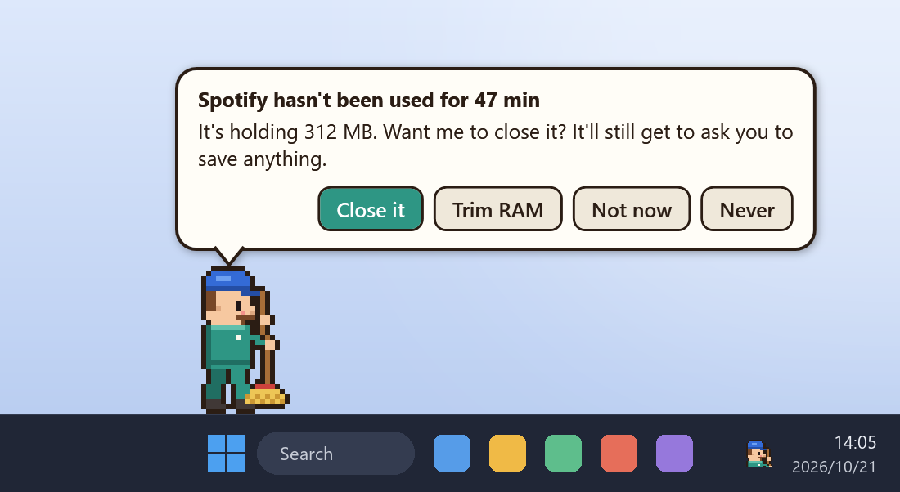
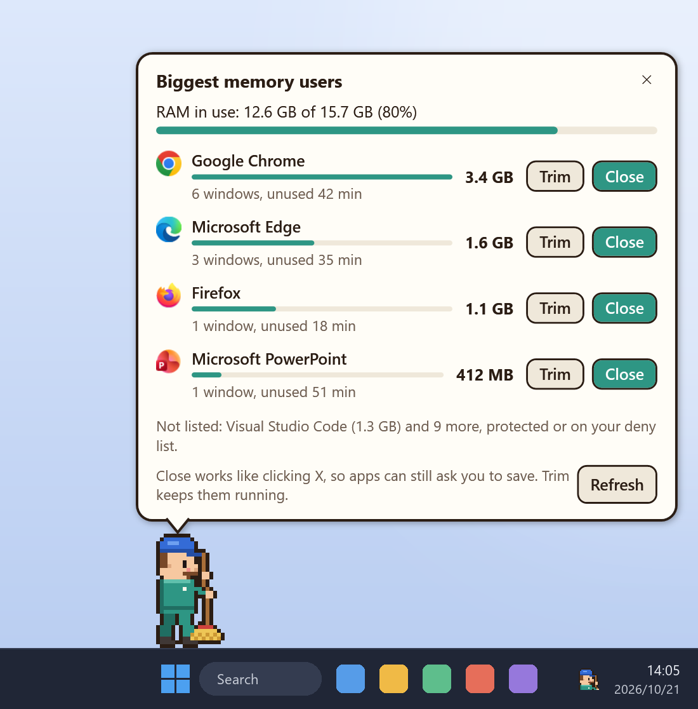
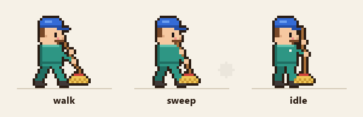
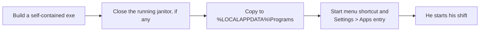
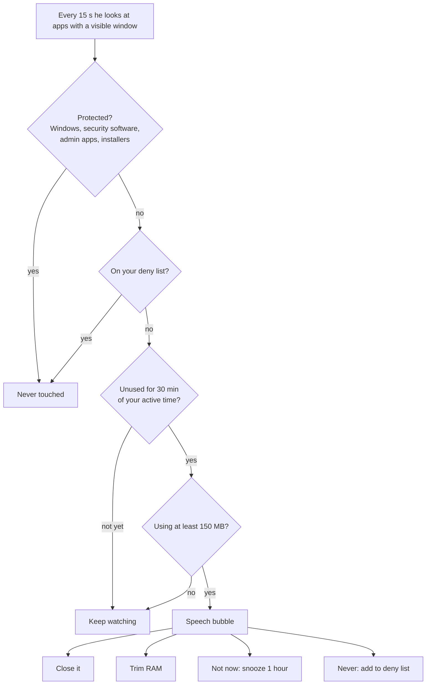
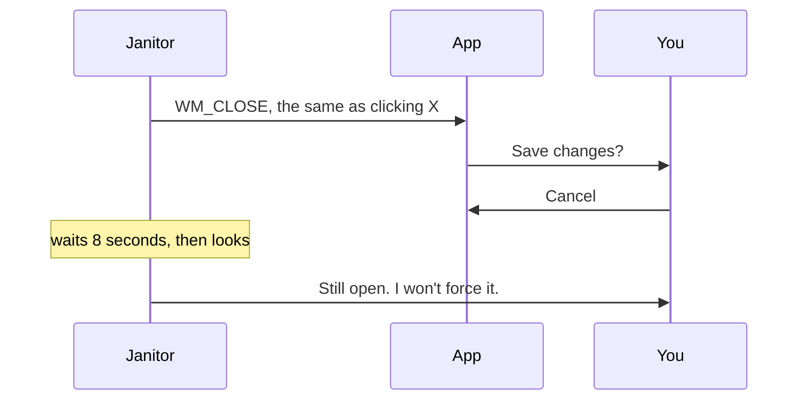
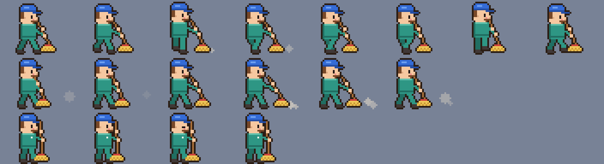
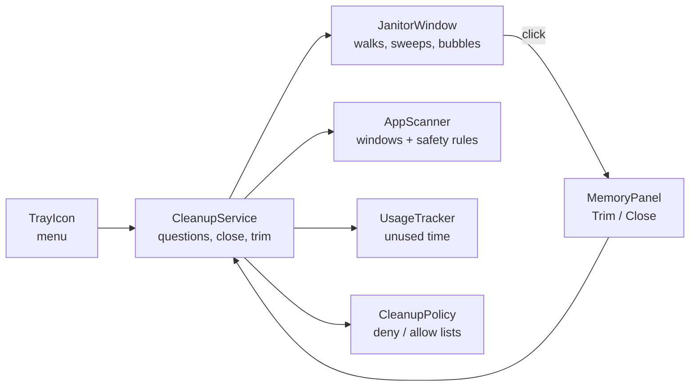

<div align="center">


# Desktop Janitor

**A tiny pixel-art janitor who sweeps along the top of your Windows taskbar,<br>
and politely tidies away the apps you've forgotten about.**


[](LICENSE)

[Features](#features) · [Install](#install) · [Using him](#using-him) · [How he decides](#how-he-decides) · [Safety](#safety-first) · [Configuration](#configuration) · [FAQ](#faq)

</div>

---

## Features

<table>
<tr>
<td width="50%" valign="top">



### He asks before he tidies

When an app has gone unused for a while, he stops and asks. You can **close it**, **trim its RAM**, say
**not now**, or say **never**. Nothing is ever closed without your click.

</td>
<td width="50%" valign="top">



### Click him to see what's eating your RAM

Click the janitor to open your memory use and the biggest apps. Each app gets one-click
**Trim** and **Close** buttons, and each row tells you what happened afterwards.

</td>
</tr>
</table>

| | |
|---|---|
| 🧹 **Lives on your taskbar** | He walks along its top edge, stops to sweep, and fades out at the right to start again from the left. |
| 🖱️ **Never in the way** | Only his drawn pixels catch the mouse. He never steals focus, isn't in Alt+Tab, and hides while you watch something fullscreen. |
| 🤝 **Closes gently** | Closing works like clicking an app's **X**, so it can still ask you to save. If it refuses, he lets it be. He never force-kills anything. |
| 🛡️ **Safe by design** | Windows itself, security software, admin apps and installers are off limits, whatever the config says. |
| 🪶 **Light** | About 50 MB of his own RAM and well under 1% CPU. He renders in software, so there's no GPU overhead. |
| 📝 **Transparent** | Everything he suggests or does is written to a plain-text log, and a report shows how he'd treat every open app. |

## Meet the janitor

<div align="center">

</div>

He's 44×32 pixels of hand-placed art, drawn by a [Python script](tools/make_sprites.py) and scaled
up with crisp pixels at any display scaling. You can [swap in your own sprite sheet](#make-it-your-own).

## Install

> **You need** 64-bit Windows 10 or 11 and the [.NET 10 SDK](https://dotnet.microsoft.com/download/dotnet/10.0).
> The SDK is only needed to build. The installed app carries its own runtime.

```powershell
git clone https://github.com/lmbangel/desktop-janitor.git
cd desktop-janitor
powershell -ExecutionPolicy Bypass -File .\install.ps1
```

The installer is per-user and **needs no admin rights**:



Run the same command again to update: your settings are kept. Options:

| Option | What it does |
|---|---|
| `-DesktopShortcut` | Also add a desktop shortcut |
| `-StartWithWindows` | Start him when you sign in (the tray menu can toggle this too) |
| `-SkipBuild` | Install the exe already in `publish\` without rebuilding |
| `-NoLaunch` | Don't start him afterwards |

**To uninstall,** go to **Settings → Apps → Installed apps → Desktop Janitor**, or run `uninstall.ps1`.
That removes the program, its shortcuts and its start-up entry. Add `-RemoveSettings` to delete your settings and log too.

## Using him

### Click him: the memory list

Hover over him and he stops walking. Click, and **Biggest memory users** opens above his head:

- **RAM in use:** a bar that turns red above 85%.
- **The biggest apps:** the top 4 by default, each with its icon, memory, window count and how long it's been unused. Memory adds up all of an app's processes, so a browser shows its real total.
- **Trim:** moves the app's idle memory out of RAM. It keeps running and nothing can be lost.
- **Close:** a gentle close. The row then shows what happened:
  - *"Closed. About 1.2 GB freed."*
  - *"Still open. It may be asking you to save."*
  - *"Window closed, still running in the tray."*
- **Not listed:** protected and deny-listed apps are never offered. The footer names the biggest one left out, so nothing is hidden from you.

The list closes when you click elsewhere, click **✕**, or click him again.

### Speech bubbles: the four buttons

| Button | What happens |
|---|---|
| **Close it** | He re-checks you haven't gone back to the app, then closes it like clicking **X**. 8 s later he tells you whether it closed, is asking you to save, or is hiding in the tray. |
| **Trim RAM** | The app keeps running. Windows moves its idle memory out of RAM, and it comes back when the app needs it. |
| **Not now** | He leaves that app alone for an hour. Ignoring the bubble for a minute does the same. |
| **Never** | He adds the app to your deny list. He'll never suggest, close or trim it again. |

He asks about one app at a time, biggest first, and waits at least 5 minutes between questions.

### The tray menu

His face lives in the notification area by the clock. Right-click it for these options:

| Menu item | What it does |
|---|---|
| Show memory list | Same as clicking him |
| Check for idle apps now | Looks right away instead of waiting for the next check |
| Sweep memory now | Trims every background app he's allowed to touch (nothing is closed) |
| What's open? (report) | A text report of every open app and what he'd do with it. Double-clicking the icon also opens it. |
| Cleanup mode | **Ask before closing** (default), **Only trim memory**, or **Off, just sweep** |
| Take a break | He stands still and asks nothing |
| Start with Windows | Toggles the start-up entry (off by default) |
| Open config · Reload config · Open log | See [Configuration](#configuration) |

To see a question bubble without waiting half an hour, start him with `--demo`. Whatever you click in that demo, nothing is touched.

## How he decides



**"Unused"** means none of the app's windows has been in front for 30 minutes **while you were actually at the PC**:

- Time away doesn't count: no input for 2 minutes, a locked screen or sleep all pause the clock. So you never come back to a pile of questions.
- Every app starts at zero when he starts, so he asks nothing in his first half hour.
- A minimised window never counts as "in front".

## Safety first

**Never touched, whatever the config says:**

| | |
|---|---|
| 🪟 Windows itself | Anything under `C:\Windows`, plus Explorer, DWM, Task Manager, the Start menu, Search and Settings |
| 🛡️ Security software | AVG, Avast, Bitdefender, ESET, Kaspersky, Malwarebytes, McAfee, Norton, Sophos, Trend Micro and Defender |
| 🔐 Privileged or foreign | Apps running as administrator, apps in another Windows session, and anything he can't inspect |
| 📦 Installers and updaters | So an install is never interrupted |
| 👻 Background processes | Anything without a visible window, such as services |

**The deny list** comes pre-filled with things you'd never want closed by surprise:

- Editors and IDEs: VS Code, PhpStorm, Visual Studio and others
- Terminals: Windows Terminal, Git Bash, Warp and others
- Database and API tools: HeidiSQL, SQLyog, DBeaver, Postman
- Local servers: Docker Desktop, Laragon, XAMPP
- File transfer: FileZilla, WinSCP
- Password managers, remote-desktop tools, and call apps like Teams and Zoom

**Closing is always gentle.** Here's what happens when an app has unsaved work:



**What to expect:** Windows already pages idle memory out when RAM gets tight, and it uses
"free" RAM as file cache. Trimming makes Task Manager's numbers drop, but some of that memory
comes back as soon as you use the app. The real wins come from closing genuinely heavy apps:
big browser sessions, Docker, chat apps. Think of him as a friendly nudge, not a turbo button.

## Configuration

Settings are in `%APPDATA%\DesktopJanitor\config.json`, which is created on first run. Edit it,
then choose **Reload config** from the tray menu.

<details>
<summary><b>All settings</b></summary>

| Setting | Default | Meaning |
|---|---|---|
| `Mode` | `Ask` | `Ask`, `TrimOnly` (never close, just trim idle apps quietly) or `Off` |
| `IdleMinutes` | `30` | Active minutes without being in front before an app counts as unused |
| `OnlyMinimized` | `false` | Only suggest apps whose windows are all minimised |
| `MinMemoryMB` | `150` | Ignore apps smaller than this |
| `PresenceTimeoutMinutes` | `2` | No input for this long means you're away |
| `SnoozeMinutes` | `60` | How long **Not now** silences an app |
| `PromptCooldownMinutes` | `5` | Minimum gap between questions |
| `PromptTimeoutSeconds` | `60` | An unanswered bubble counts as **Not now** after this |
| `AllowList` | `[]` | If not empty, **only** these apps are ever suggested |
| `AutoCloseApps` | `[]` | Idle apps closed gently **without asking**. Empty means always ask. |
| `DenyList` | *see above* | Never suggested, closed or trimmed |
| `Clickable` | `true` | Click him for the memory list. `false` makes him fully click-through. |
| `MemoryListSize` | `4` | How many apps the memory list shows |
| `WalkSpeed` | `40` | Pixels per second |
| `Scale` | `3` | Size of each art pixel; it's rounded so pixels stay crisp at any display scaling |
| `SweepBreaks` | `true` | Stop every few seconds for a proper sweep |
| `HideInFullscreen` | `true` | Hide during fullscreen video, games and presentations |
| `Sprite` | built-in | A custom sprite sheet ([see below](#make-it-your-own)) |

App names are process names without `.exe`, as shown in brackets in the report (`chrome`, `spotify`, `ms-teams`).

</details>

<details>
<summary><b>Files and command-line flags</b></summary>

| Path | What |
|---|---|
| `%APPDATA%\DesktopJanitor\config.json` | Your settings |
| `%LOCALAPPDATA%\DesktopJanitor\janitor.log` | Everything he suggested or did |
| `%LOCALAPPDATA%\DesktopJanitor\report.txt` | The latest "What's open?" report |
| `%LOCALAPPDATA%\Programs\DesktopJanitor\` | The installed app |

| Flag | What it does |
|---|---|
| `--demo` | Shows a sample question a few seconds after starting (nothing is touched) |
| `--memory-list` | Opens the memory list right after starting |
| `--report` | Writes the report and exits |
| `--config <file>` | Uses a different config file |
| `--exit` | Asks a running janitor to quit (the installer uses this) |
| `--snapshots <dir>` | Renders the README's bubble and memory list with sample data |

</details>

## Make it your own

The sprite sheet has one row per animation. Frames run left to right, he faces right, and
his feet sit on the bottom edge of each frame:



You can change the art in either of two ways:

- Edit [`tools/make_sprites.py`](tools/make_sprites.py) and run it.
- Point the config at your own PNG. Free sheets are available on itch.io and OpenGameArt (check the licence), or you can draw your own in [Piskel](https://www.piskelapp.com/) or Aseprite.

```json
"Sprite": {
  "Path": "C:\\path\\to\\my-sheet.png",
  "FrameWidth": 44, "FrameHeight": 32,
  "Walk":  { "Row": 0, "Frames": 8, "Fps": 10 },
  "Sweep": { "Row": 1, "Frames": 6, "Fps": 10 },
  "Idle":  { "Row": 2, "Frames": 4, "Fps": 3 }
}
```

## Build from source

```powershell
dotnet run --project src/DesktopJanitor            # run it
dotnet run --project src/DesktopJanitor -- --demo  # run it with a sample question
```

To regenerate the art and the README images (needs Python with Pillow):

```powershell
python tools/make_sprites.py --preview docs/sprites.png
dotnet run --project src/DesktopJanitor -- --snapshots docs/ui
python tools/make_readme_art.py
```

<details>
<summary><b>How it's put together</b></summary>



```
src/DesktopJanitor/
  App.xaml(.cs)        start-up, single instance, command line, shared styles
  JanitorWindow.*      the sprite window: walking, sweeping, fading, clicks
  SpeechBubble.*       question and remark bubbles
  MemoryPanel.*        the click-the-janitor memory list
  CleanupService.cs    idle checks, questions, gentle close, trimming
  AppScanner.cs        finds app windows, applies the hard safety rules
  UsageTracker.cs      "unused" bookkeeping
  CleanupPolicy.cs     deny and allow lists
  JanitorConfig.cs     settings and defaults
  TrayIcon.cs          tray menu
  Snapshots.cs         README renders
  Native.cs            Win32 calls
tools/                 sprite and README art generators
install.ps1            per-user install (Start menu and Settings > Apps entry)
uninstall.ps1          removes it again
```

</details>

## FAQ

<details>
<summary><b>Will he close something I'm working on?</b></summary>

Not without you. By default he only *asks*, and even when you say yes he only does what clicking
**X** does. Apps with unsaved work get to ask you to save, and if one says no, he leaves it alone.
Apps you used in the last 30 minutes (of your active time) are never suggested.
</details>

<details>
<summary><b>Does trimming really free memory?</b></summary>

It moves the app's idle pages out of RAM right away, so you'll see the numbers drop. Pages the app
touches again come back, so the lasting gain depends on how idle the app really is. Closing heavy
apps you don't need is what makes the biggest difference.
</details>

<details>
<summary><b>Why is the installed exe 165 MB if he only uses about 50 MB of RAM?</b></summary>

It's self-contained: it carries the .NET 10 and WPF runtime, so it runs on any machine without
installing .NET. On disk that's big; in memory he only loads what he needs. If you already have
the .NET 10 Desktop Runtime installed machine-wide, you can publish a framework-dependent build of
under 300 KB instead (`--self-contained false`).
</details>

<details>
<summary><b>The installer says "No .NET 10 SDK found", but I installed it</b></summary>

The installer looks in these places, in order:

- `%USERPROFILE%\.dotnet`
- `%LOCALAPPDATA%\Microsoft\dotnet`
- the `dotnet` on your PATH
- `C:\Program Files\dotnet`

If you installed the SDK from a terminal running *inside* a packaged (Store/MSIX) app, Windows may
have quietly redirected it into that app's private storage, where other terminals can't see it.
Install it to `%USERPROFILE%\.dotnet` instead (`dotnet-install.ps1 -InstallDir $HOME\.dotnet`), or
use Microsoft's regular installer.
</details>

<details>
<summary><b>The installer says the old exe is still in use</b></summary>

Antivirus often scans a freshly copied exe for a few seconds. The installer waits up to 30 seconds
and retries. If it still can't replace the file, wait a minute and run it again.
</details>

<details>
<summary><b>Where's my tray icon?</b></summary>

Windows 11 hides new tray icons. Click the **^** by the clock, or turn him on under
**Settings → Personalization → Taskbar → Other system tray icons**.
</details>

## Limitations

- He walks on the primary monitor, along the bottom taskbar.
- Apps are grouped by process name, so two different apps sharing an exe name count as one.
- Store (UWP) apps run inside `ApplicationFrameHost`, which is protected, so they're never suggested.
- A background app playing audio can still be suggested if you haven't looked at it. Click **Never** for your music player.

## License

[MIT](LICENSE) © lmbangel
